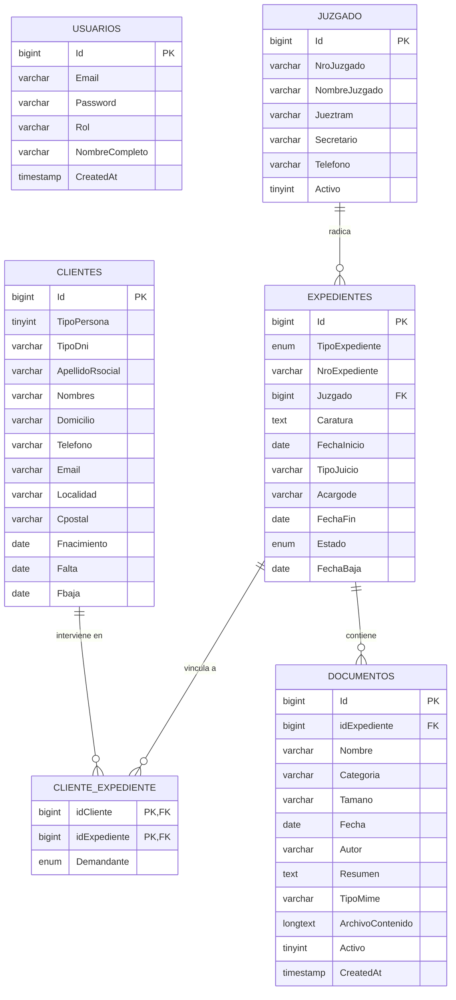
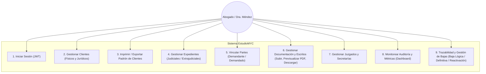

# EstudioMYC — Sistema de Gestión Jurídica Integral

> **Proyecto Final de Cátedra**  
> **Materia:** Gestión de Software II (ISCA 4014)  
> **Docente Titular:** Prof. Walter Lauxman  
> **Alumna:** Julia Rodriguez  
> **Cliente / Estudio:** Estudio Jurídico M&C 
> **Fecha de Entrega:** Octubre 2026  

---

## 1. Resumen del Proyecto

**EstudioMYC** es un software de gestión jurídica integral diseñado para optimizar el seguimiento de expedientes, clientes y radicaciones judiciales del **Estudio Jurídico M&C**. 

El sistema reemplaza planillas y registros dispersos por una plataforma web segura, rápida y moderna bajo arquitectura cliente-servidor desacoplada (API RESTful + SPA), con autenticación mediante JSON Web Tokens (JWT) y una interfaz de usuario bajo la estética **Dark Glass** (berenjena profundo, vidrio esmerilado y acentos en dorado champán).

---

## 2. Stack Tecnológico

| Capa | Tecnología | Descripción |
| :--- | :--- | :--- |
| **Base de Datos** | MySQL 8.x / 9.x (WampServer) | Base de datos relacional normalizada `MYC` con 6 tablas e integridad referencial |
| **Backend API** | Node.js + Express.js | API RESTful modular (puerto `4000`) con `mysql2/promise`, `bcryptjs`, `jsonwebtoken` y middleware de autenticación |
| **Frontend Web** | React 19 + Vite | Single Page Application (puerto `5173`) reactiva con Context API y React Router DOM |
| **Notificaciones** | Toast System (React Context) | Sistema no intrusivo de toasts estilizados Dark Glass que reemplaza popups `alert()` nativos |
| **Trazabilidad** | Soft Delete + Reactivación | Soporte dual de baja lógica (`Activo=0`, `Fbaja`, `FechaBaja`) y eliminación definitiva con modal confirmatorio |
| **Iconografía** | Lucide React | Iconografía vectorial moderna y consistente |
| **Estilo Visual** | CSS Vanilla (Dark Glass) | Glassmorphism elegante, paleta `#0B080F`, `#100C12`, `#251A2B`, dorado `#D4B16A` y tipografía *Cinzel* + *Plus Jakarta Sans* |
| **Reportes** | Motor de Impresión CSS (`@media print`) | Generación y exportación de padrones en PDF listos para imprimir con membrete oficial |

---

## 3. Diagrama Entidad-Relación (DER)

El modelo de datos se encuentra normalizado en tercera forma normal (3FN) garantizando integridad referencial mediante claves foráneas y restricciones `ON DELETE RESTRICT` / `ON DELETE CASCADE`:



---

## 4. Diagrama de Casos de Uso del Sistema



---

## 5. Módulos y Requerimientos Implementados

### A. Autenticación y Seguridad
- Inicio de sesión con correo institucional y contraseña encriptada con `bcryptjs` (salt rounds 10).
- Manejo de sesión mediante token JWT con vigencia de 4 horas almacenado en `localStorage`.
- Interceptores en Axios que inyectan el encabezado `Authorization: Bearer <token>` y redirigen automáticamente ante sesiones caducadas.

### B. Gestión de Clientes y Padrón Oficial (Paso B)
- **ABM completo de clientes**: Soporte diferenciado para **Personas Físicas** (DNI, Nombres y Apellido) y **Personas Jurídicas** (CUIT, Razón Social y Representante Legal).
- **Protección de Integridad Referencial**: Impide eliminar clientes que tengan causas en trámite en la tabla `cliente_expediente`.
- **Filtros Dinámicos**: Búsqueda en tiempo real por texto (apellido, DNI, ciudad) y filtrado por tipo de persona.
- **Paso B — Impresión de Padrón Oficial**: Botón **"Imprimir Padrón"** que genera una vista formal con membrete legal del Estudio, matrícula profesional, fecha de emisión, resumen cuantitativo, listado tabular de clientes y campo para firma y sello. Compatible con exportación directa a **PDF**.

### C. Gestión de Causas y Expedientes
- Clasificación entre trámites **Judiciales (J)** y **Extrajudiciales (E)**.
- Vinculación automática con el tribunal correspondiente en la tabla `juzgado`.
- Estados de tramitación: *Activo*, *Resuelto favorable* y *Archivado*.
- Asociación de múltiples clientes por causa como *Demandante* o *Demandado*.

### D. Gestión de Documentación y Escritos Asociados
- **Modal interactivo de "Documentos"** accesible directamente desde cada ficha de expediente en el padrón.
- **Persistencia en Base de Datos**: Almacenamiento normalizado en la tabla `documentos` de MySQL, incluyendo metadatos (categoría, fecha, autor, resumen, tamaño, tipo MIME) y contenido codificado en Base64 (`ArchivoContenido`).
- **Adjuntar archivos desde la PC**: Carga directa de archivos PDF, imágenes (.png, .jpg) o escritos judiciales procesados localmente.
- **Visor Embebido en Tiempo Real**: Renderizado interactivo de PDFs e imágenes directamente en el navegador mediante iframe integrado y modales con opción de apertura en pestaña completa.
- **Descargas Oficiales**: Descarga del archivo digital original o generación de copia digital con encabezado, membrete institucional del Estudio Jurídico M&C y firma de la letrada titular.
- **Clasificación procesal**: Demanda, Contrato, Poder, Cédula, Prueba y Sentencia.
- **Trazabilidad documental**: Soporte de baja lógica (`Activo = 0`) para desafectar escritos sin eliminarlos del expediente, con posibilidad de reactivación.

### E. Gestión de Juzgados
- Registro de tribunales: Número, nombre oficial, juez de trámite, secretario y teléfonos de contacto.
- Validación de integridad: Bloqueo de eliminación si existen expedientes radicados en el juzgado.
- Control de estado operativo: Baja lógica (`Activo = 0`) para juzgados desafectados y reactivación inmediata.

### F. Dashboard de Auditoría y Métricas
- Tarjetas de indicadores en tiempo real: Expedientes Activos, Total de Clientes, Juzgados Vinculados y Tasa de Éxito.
- Feed de auditoría con las últimas resoluciones y movimientos procesales.
- Accesos directos y tabla de causas recientes.

### G. Trazabilidad de Datos, Bajas Lógicas (Soft Delete) y Reactivación
- **Principio de Trazabilidad Jurídica**: En la administración judicial y el ejercicio profesional no es admisible la destrucción accidental o eliminación física de registros con causas históricas. El sistema prioriza la **baja lógica** para mantener auditoría y cumplimiento normativo.
- **Variables de Control por Entidad**:
  - `clientes`: Campo `Fbaja` (`date`). Si contiene fecha, el cliente permanece inactivo con distintivo visual en la interfaz.
  - `expedientes`: Campos `FechaBaja` (`date`) y estado `Archivado`.
  - `juzgado`: Campo `Activo` (`tinyint(1)`).
  - `documentos`: Campo `Activo` (`tinyint(1)`).
- **Diálogo Modal Dark Glass de Confirmación (`ModalConfirmacionBaja`)**:
  - Sustituye los confirmadores nativos del navegador por una interfaz explicativa con dos niveles de acción:
    1. **Dar de baja lógica (Inactivar)**: Recomendado. Preserva el registro, sus vínculos procesales y la trazabilidad.
    2. **Eliminación Definitiva (Hard Delete)**: Ejecuta `DELETE` físico en MySQL previa comprobación de integridad foránea.
  - **Reactivación**: Permite a la letrada reactivar cualquier entidad inactiva mediante un solo clic a través del verbo `PATCH /api/:entidad/:id/reactivar`.

### H. Sistema de Notificaciones Dark Glass (Toasts)
- **Eliminación total de alertas nativas**: Se reemplazaron todos los `alert()` y `confirm()` del navegador.
- **Context API (`ToastContext` / `useToast()`)**: Mensajes flotantes con micro-animaciones, cierre automático tras 4.5 segundos y estilos dedicados para `success`, `error`, `warning` e `info`.
- **Favicon Institucional**: Icono vectorial oficial de la Balanza de la Justicia en oro champán (`#D4B16A`) sobre fondo Dark Plum (`#0B080F`).

---

## 6. Guía de Instalación y Puesta en Marcha

### Requisitos Previos
- **WampServer** (o MySQL Server 8.0+ en puerto `3306`)
- **Node.js** v18+ y **npm** v9+

---

### Paso 1: Configurar la Base de Datos MySQL
1. Iniciar **WampServer** y abrir phpMyAdmin (`http://localhost/phpmyadmin`).
2. Crear una base de datos llamada `MYC` (cotejamiento `utf8mb4_general_ci`).
3. Importar el archivo script ubicado en la raíz del proyecto:
   ```text
   C:\wamp64\www\estudio-juridico\myc.sql
   ```
4. El script creará automáticamente las 6 tablas con sus relaciones y datos de prueba (`usuarios`, `clientes`, `juzgado`, `expedientes`, `cliente_expediente`, `documentos`).

---

### Paso 2: Iniciar la API Backend
1. Abrir una terminal en la carpeta `backend-api`:
   ```bash
   cd C:\wamp64\www\estudio-juridico\backend-api
   ```
2. Instalar las dependencias (si no se hizo previamente):
   ```bash
   npm install
   ```
3. Verificar el archivo `.env`:
   ```env
   PORT=4000
   DB_HOST_MYC=localhost
   DB_NAME_MYC=MYC
   DB_USER_MYC=root
   DB_PASSWORD_MYC=
   DB_PORT_MYC=3306
   JWT_SECRET_MYC=estudio_juridico_myc_secret_key_2026_segura
   ```
4. Iniciar el servidor:
   ```bash
   npm run dev
   ```
   > El backend quedará escuchando en `http://localhost:4000`.

---

### Paso 3: Iniciar la Aplicación Frontend React
1. Abrir otra terminal en la carpeta `frontend-react`:
   ```bash
   cd C:\wamp64\www\estudio-juridico\frontend-react
   ```
2. Instalar las dependencias:
   ```bash
   npm install
   ```
3. Iniciar el entorno de desarrollo:
   ```bash
   npm run dev
   ```
4. Abrir en el navegador la URL indicada (habitualmente `http://localhost:5173`).

---

## 7. Credenciales de Acceso para Pruebas

Para acceder a todas las funcionalidades del sistema en el coloquio:

- **Correo Electrónico:** `admin@estudiomyc.com`
- **Contraseña:** `admin123`
- **Usuario:** Dra. María Belén Méndez
- **Rol:** `abogado` (Administrador General)

---

## 8. Estructura del Repositorio

```text
estudio-juridico/
├── myc.sql                             # Volcado SQL oficial de la base de datos MYC (6 tablas normalizadas)
├── README.md                           # Documentación técnica y académica de entrega
├── Etapa 1 y 2 Coloquio.docx           # Documento de especificación de requisitos y Scrum
│
├── backend-api/                        # Servidor RESTful Node.js + Express
│   ├── .env                            # Variables de entorno y credenciales MySQL
│   ├── .gitignore                      # Exclusión de dependencias, variables y logs
│   ├── server.js                       # Entrada principal de la aplicación Express
│   ├── package.json                    # Dependencias backend (mysql2, jsonwebtoken, bcryptjs, cors)
│   └── src/
│       ├── db.js                       # Pool de conexiones MySQL con promesas
│       ├── middleware/                 # Middlewares de seguridad e interceptación
│       │   └── autenticar.middleware.js # Validación de JWT (Bearer Token)
│       ├── controller/                 # Controladores con lógica de negocio, trazabilidad y validación
│       │   ├── autenticacion.controller.js
│       │   ├── cliente.controller.js   # ABM de clientes con baja lógica (Fbaja) y reactivación
│       │   ├── documento.controller.js # Alta, previsualización, baja lógica y definitiva de escritos
│       │   ├── expediente.controller.js # Gestión de causas, vinculación de partes y archivo
│       │   └── juzgado.controller.js   # Registro de juzgados y control de estado operativo
│       └── routes/                     # Definición de endpoints REST y rutas protegidas
│           ├── autenticacion.routes.js
│           ├── clientes.routes.js
│           ├── documentos.routes.js    # Endpoints para gestión de documentación de causas
│           ├── expedientes.routes.js
│           └── juzgados.routes.js
│
└── frontend-react/                     # Aplicación SPA React 19 + Vite
    ├── index.html                      # Punto de entrada HTML5 con Google Fonts y título oficial
    ├── package.json                    # Dependencias frontend (lucide-react, react-router-dom, axios)
    ├── vite.config.js                  # Configuración de compilación Vite
    ├── public/
    │   ├── favicon.svg                 # Emblema oficial de la Balanza de la Justicia en oro champán
    │   ├── icons.svg                   # Sprite de iconos auxiliares
    │   └── img/                        # Recursos gráficos y fondos Dark Glass
    └── src/
        ├── index.css                   # Sistema de diseño Dark Glass, Toasts y reglas de impresión
        ├── App.jsx                     # Rutas protegidas, providers y layout principal
        ├── main.jsx                    # Montaje de la aplicación React
        ├── api/
        │   └── axios.js                # Instancia de Axios con interceptor de JWT
        ├── context/
        │   ├── AutenticacionContexto.jsx
        │   ├── AutenticacionProvider.jsx
        │   ├── EstudioContext.jsx
        │   ├── EstudioProvider.jsx     # Contexto global del estudio (ABM, Soft Delete, Reactivación)
        │   └── ToastContext.jsx        # Provider de notificaciones Toasts personalizadas
        └── components/
            ├── Login.jsx               # Pantalla de acceso con estética Dark Glass
            ├── Dashboard.jsx           # Panel de control con métricas y auditoría
            ├── Sidebar.jsx             # Barra lateral fija con identidad de marca
            ├── TopBar.jsx              # Barra superior con buscador y perfil de usuario
            ├── common/
            │   └── ModalConfirmacionBaja.jsx # Modal Dark Glass para baja lógica, hard delete y reactivación
            ├── clientes/
            │   ├── ClienteItem.jsx     # Tarjeta individual con edición, badges de baja y confirmador
            │   ├── FormularioCliente.jsx # Formulario de alta para físicas y jurídicas
            │   └── VistaCliente.jsx    # Listado, filtros y Padrón Imprimible (Paso B)
            ├── expedientes/
            │   ├── ExpedienteItem.jsx  # Ficha de causa, partes vinculadas, estado y botón docs
            │   ├── FormularioExpediente.jsx # Formulario de alta de causas
            │   ├── ModalDocumentos.jsx # Gestión integral de documentación, visor PDF y descargas
            │   └── VistaExpediente.jsx # Listado de expedientes con filtros de estado
            └── juzgados/
                ├── FormularioJuzgado.jsx # Registro de tribunales y fueros
                ├── JuzgadoItem.jsx     # Tarjeta de juzgado con datos de secretaría y baja lógica
                └── VistaJuzgado.jsx    # Directorio de juzgados
```

---

*EstudioMYC — Desarrollado por Julia Rodriguez para la materia de Gestión de Software II*
